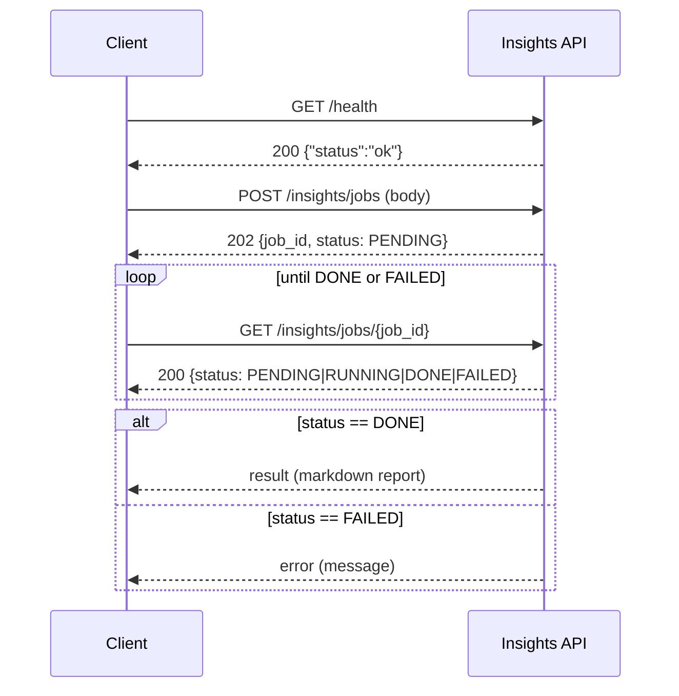

## At a glance

| Step | Method & path | Returns |
| --- | --- | --- |
| Submit a query | `POST /insights/jobs` | `202` `{ "job_id", "status": "PENDING" }` |
| Poll a job | `GET /insights/jobs/{job_id}` | `200` `{ job_id, status, result, error, created_at, updated_at }` |
| Health check | `GET /health` | `{ "status": "ok" }` |

Job `status` is one of `PENDING | RUNNING | DONE | FAILED`. Terminal states are
`DONE` (read `result`) and `FAILED` (read `error`). `result` holds the markdown
report and is populated only once the job is `DONE`.

## Environments and access

| Environment | Base URL |
| --- | --- |
| dev | `https://insights.dev.internal-liberate.com` |
| prod | `https://insights.prod.internal-liberate.com` |

**You must be on the VPN.** Both base URLs are served by the `contour-internal`
ingress and are not reachable from the public internet; requests will hang or
fail to connect if you are not connected to the VPN. If `/health` is
unreachable, check your VPN connection before debugging anything else.

The submit and poll routes (`POST /insights/jobs`, `GET /insights/jobs/{job_id}`)
do **not** require a bearer token; access is gated by the VPN and the internal
ingress. The service's other route, `POST /insights/ingest`, requires
`ANONYMIZER_AUTH_TOKEN`, but you do not need it to query.

## Inputs

The submit body (`SubmitInsightsQueryRequest`) takes:

| Field | Required | Notes |
| --- | --- | --- |
| `bucket_name` | yes | S3 bucket holding the conversation data. |
| `org_id` | yes | Organization identifier. |
| `project_id` | yes | Project identifier. |
| `agent_id` | yes | Agent **or** multi-agent identifier. |
| `query` | yes | The natural-language question about the conversations. |
| `conversation_environment` | no | `"PROD"` (default) or `"QA"`. |
| `conversation_ids` | no | Explicit list of conversation IDs to analyze (max 500). |
| `sample_start_date` | no | Inclusive `YYYY-MM-DD` start of the sampling window (UTC). |
| `sample_end_date` | no | Inclusive `YYYY-MM-DD` end of the sampling window (UTC). |

The first four are opaque slugs the user will not know. See
Resolving identifiers — look them up from
telephony-manager-api rather than asking.

### Targeting which conversations are analyzed

Choose exactly one of three modes:

1. **Explicit IDs** — set `conversation_ids` to a non-empty list of at most

500 IDs. More than 500 fails the job (`requested N conversations (max 500)`);
the list is not sampled down. If none of the IDs can be loaded, the job fails
with `No conversations were found for the requested IDs.`
2. **Date window** — set `sample_start_date`, `sample_end_date`, or both (both
inclusive; start must not be after end). With only a start, the window ends
now; with only an end, it starts 30 days before the end. The service samples
up to 300 conversations within that window.
3. **Default** — omit all of the above; the service samples from the last
30 days.

`conversation_ids` takes precedence: if it is set, the dates are ignored.

The window filters on the S3 `LastModified` time (UTC) of each conversation's
`call_config` object, not on a call date stored in the data. A wide window is
sampled down to 300 rather than analyzed in full.

The initial set is not the only data the report can draw on. During a run, the
agent can fetch up to 5000 more conversations for the same agent, and it can
search conversation records for that agent in TurboPuffer.

## Resolving identifiers

`bucket_name`, `org_id`, `project_id`, and `agent_id` are opaque slugs. Do not
ask the user for them and do not guess — look them up in
**telephony-manager-api** (TMA), the system of record for the Organization →
Project → Agent hierarchy that insights reads.

| Environment | TMA base URL |
| --- | --- |
| dev | `https://telephony-manager-api-dev.liberateinc.io/api/v1` |
| prod | `https://tel-manager-api-prod.liberateinc.com/api/v1` |

Note the prod host is `tel-manager-api-prod`, **not** `telephony-manager-api-prod`
(that name does not resolve). Same VPN requirement as insights. Health
check is `GET /api/v1/health`.

### The lookup

Start from whatever the user said ("nationwide", "the sixt subrogation agent")
and resolve in two steps.

**1. Find the organization** by display-name substring (case-insensitive):

```
GET /organizations?displayName=nationwide
```

Returns a JSON array. Each record gives you two of the four fields:

- `org_id` = the record's `orgId`
- `bucket_name` = `{tenantId}-athena-liberate-prod`

That bucket rule is exact — it reproduces all 16 tenants in the fallback table
below. Do not build the bucket from `orgId`; the two diverge, e.g. org
`save-money-car-insurance-sc0wyTjq1A7c` has `tenantId` `save-money` and so
bucket `save-money-athena-liberate-prod`.

**2. List the candidate agents** for that org. Query **both** collections,
because an insights `agent_id` is either an Agent or a MultiAgent:

```
GET /agents?organization.orgId=<org_id>
GET /multiAgents?organization.orgId=<org_id>
```

Both nest their project, so `project_id` comes from the same response
(`.project.projectId` on either) — no separate `/projects` call needed. Take
`agent_id` from `.agentId` or `.multiAgentId` respectively.

Other useful filters: `/organizations` also accepts exact `orgId`; `/agents`
accepts `project.projectId`, `displayName`, `agentId`, and
`communicationChannel`. `/organizations`, `/projects`, and `/agents` support
`_sort`/`_order`/`_start`/`_end` and set an `x-total-count` header — omit
`_start` to get the full unpaginated list. `/multiAgents` has no pagination.
Always drop records where `isActive` is false or `isDeleted` is true.

### Picking the right agent

**The** `-MA` **/** `-AG` **suffix does not tell you which collection an id belongs
to.** Suffixes were only introduced 2025-09-02; anything older is a bare slug.
`verve-auto-fnol-5DE9BBmbk5iV` has no suffix and is a MultiAgent;
`branch-auto-fnol-djGDkGiqsZof` has no suffix and is an Agent. Resolve against
both endpoints rather than reading the suffix.

`/agents` also returns every **sub-agent** of a multi-agent flow (coordinator,
authentication, vehicle-intake, …), which are not valid insights targets.
Filter them out: any `agentId` appearing in some MultiAgent's
`coordinatorAgent`, `callIntentAgent`, `baseAgent`, or `intents[].steps[].agent`
is a sub-agent. On prod this drops 534 of 1060 agents and removes none of the
known-good targets below.

After filtering, a tenant often still has several candidates — separate lines
of business, English vs Spanish, leftover test agents. Nothing in TMA marks
which ones actually have conversation data in S3: `isDefault`, `parentId`, and
phone-number counts do not discriminate. So **show the survivors to the user
with their** `displayName` **and let them choose**, rather than picking silently.

### Python helper

Resolves a tenant name to the identifiers `query_insights` needs. Standard
library only; pairs with the `query_insights` function further below.

```python
import json
import urllib.parse
import urllib.request

TMA_BASE_URLS = {
    "dev": "<https://telephony-manager-api-dev.liberateinc.io/api/v1>",
    "prod": "<https://tel-manager-api-prod.liberateinc.com/api/v1>",
}

def _tma_get(base_url, path, params):
    url = f"{base_url}{path}?{urllib.parse.urlencode(params)}"
    with urllib.request.urlopen(urllib.request.Request(url), timeout=60) as resp:
        return json.loads(resp.read().decode("utf-8"))

def _live(records):
    return [r for r in records if r.get("isActive") and not r.get("isDeleted")]

def resolve_tenant(name=None, org_id=None, tma_base_url=TMA_BASE_URLS["prod"]):
    """Resolve a tenant to insights identifiers, by display name or exact org id.

    Returns ``(org, candidates)``. ``org`` carries ``bucket_name`` and
    ``org_id``; each candidate carries ``project_id``, ``agent_id``,
    ``display_name`` and ``kind`` ("agent" or "multiAgent"). Present the
    candidates to the user and let them pick the one to query.

    Raises:
        RuntimeError: If no active organization matches, or if ``name`` matches
            several — the message lists them; re-call with ``org_id`` set to
            the right one.
    """
    query = {"orgId": org_id} if org_id else {"displayName": name}
    orgs = _live(_tma_get(tma_base_url, "/organizations", query))
    if not orgs:
        raise RuntimeError(f"no active organization matching {org_id or name!r}")
    if len(orgs) > 1:
        matches = ", ".join(f"{o['displayName']} ({o['orgId']})" for o in orgs)
        raise RuntimeError(
            f"{name!r} matches several orgs; re-call with org_id=: {matches}"
        )
    org = orgs[0]
    org_id = org["orgId"]

    agents = _live(_tma_get(tma_base_url, "/agents", {"organization.orgId": org_id}))
    multi = _live(_tma_get(tma_base_url, "/multiAgents", {"organization.orgId": org_id}))

    # Agents owned by a multi-agent flow are not standalone insights targets.
    sub_agent_ids = set()
    for m in multi:
        for key in ("coordinatorAgent", "callIntentAgent", "baseAgent"):
            ref = m.get(key) or {}
            if ref.get("agentId"):
                sub_agent_ids.add(ref["agentId"])
        for intent in m.get("intents") or []:
            for step in intent.get("steps") or []:
                ref = step.get("agent") or {}
                if ref.get("agentId"):
                    sub_agent_ids.add(ref["agentId"])

    candidates = [
        {
            "kind": "multiAgent",
            "agent_id": m["multiAgentId"],
            "project_id": m["project"]["projectId"],
            "display_name": m["displayName"],
        }
        for m in multi
    ] + [
        {
            "kind": "agent",
            "agent_id": a["agentId"],
            "project_id": a["project"]["projectId"],
            "display_name": a["displayName"],
        }
        for a in agents
        if a["agentId"] not in sub_agent_ids
    ]

    resolved_org = {
        # The bucket convention is prod-only; dev conversation data lives elsewhere.
        "bucket_name": f"{org['tenantId']}-athena-liberate-prod",
        "org_id": org_id,
        "display_name": org["displayName"],
    }
    return resolved_org, candidates
```

Wiring it into a query:

```python
# Tenant names are often ambiguous — "nationwide" matches two orgs, so this
# raises and lists them; re-call with the org_id the user meant.
org, candidates = resolve_tenant(org_id="nationwide-fnol-IO4Rp5KDzYWA")
for c in candidates:
    print(f"{c['kind']:10} {c['agent_id']}  ({c['display_name']})")

chosen = candidates[0]  # in practice, confirm this with the user first
report = query_insights(
    base_url=BASE_URLS["prod"],
    bucket_name=org["bucket_name"],
    org_id=org["org_id"],
    project_id=chosen["project_id"],
    agent_id=chosen["agent_id"],
    query="Please summarize agent quality, grouped by day",
)
```

### Deriving the identifiers from an S3 prefix

If you already have a prefix, you can read the fields straight off it.
Conversation data lives under:

```
conversations/{org_id}/{project_id}/{agent_id}/{ENV}/{conversation_id}/...
```

So given a prefix like:

```
conversations/nationwide-fnol-IO4Rp5KDzYWA/nationwide-auto-fnol-multi-agent-K5KgSPRv3FBc/nationwide-auto-fnol-agent-g3_HaCPixh7h-AG/PROD/
```

the fields are:

- `org_id` = `nationwide-fnol-IO4Rp5KDzYWA`
- `project_id` = `nationwide-auto-fnol-multi-agent-K5KgSPRv3FBc`
- `agent_id` = `nationwide-auto-fnol-agent-g3_HaCPixh7h-AG`
- `conversation_environment` = `PROD`

(The bucket is supplied separately as `bucket_name`.)

### Known-good identifiers (prod fallback)

Use these when TMA is unreachable, or to sanity-check a lookup. This is a
snapshot of tenants that have been queried before — **not** the set of valid
targets, and it goes stale as agents are added. Prefer the TMA lookup. All
entries use `conversation_environment = "PROD"`. `Kind` says which TMA
collection the `agent_id` came from, verified against prod.

| Tenant | Kind | `bucket_name` | `org_id` | `project_id` | `agent_id` |
| --- | --- | --- | --- | --- | --- |
| sagesure | multiAgent | `sagesure-athena-liberate-prod` | `sagesure-C6SAjoVLEDPl` | `sagesure-property-fnol-KMc54RNIGIe4` | `sagesure-property-fnol-jd4XtTH0LunI` |
| ais | multiAgent | `ais-athena-liberate-prod` | `ais-ZTTbSaMwrmuC` | `ais-servicing-multi-agent-xrQZjPAXYB06` | `ais-servicing-multi-agent-7k6n-t4PCcRp-MA` |
| goosehead | multiAgent | `goosehead-athena-liberate-prod` | `goosehead-RE1Zdw847BLw` | `goosehead-phase-0-7DlOZa0GeFKS` | `nice-goosehead-implementation-DWt3p2RGQtXz-MA` |
| mendota | multiAgent | `mendota-athena-liberate-prod` | `mendota-vUBRbFrZ9U32` | `mendota-fnol-multi-agent-dbP4Jkpue0Ff` | `mendota-multi-agent-fnol-xFrkmWMumagw-MA` |
| avis | multiAgent | `avis-athena-liberate-prod` | `avis-YjAGKsKrTUk3` | `avis-dmp-fnol-h0nsXBYHH0jl` | `avis-dmp-fnol-clone-o0dp5snV3dJ_` |
| aspire | multiAgent | `aspire-athena-liberate-prod` | `aspire-gF5NyeXo60TB` | `aspire-fnol-a4jebQQGGgel` | `aspire-fnol-ruoUVil6PZRk-MA` |
| aspire | multiAgent | `aspire-athena-liberate-prod` | `aspire-gF5NyeXo60TB` | `aspire-spanish-fnol-8qfUMP6rdABN` | `aspire-spanish-fnol-gN66JMvmTRed-MA` |
| verve | multiAgent | `verve-athena-liberate-prod` | `verve-QLgdLH_7vH8D` | `verve-fnol-QiTX1FOeNUtt` | `verve-auto-fnol-5DE9BBmbk5iV` |
| polly | multiAgent | `polly-athena-liberate-prod` | `polly-insurance-agency-0tNAkENZHGEu` | `polly-inbound-sales-agent-p1fFkqG8EYl3` | `polly-insurance-inbound-quoting-8mwTZuFgjrog-MA` |
| nationwide | agent | `nationwide-athena-liberate-prod` | `nationwide-fnol-IO4Rp5KDzYWA` | `nationwide-auto-fnol-multi-agent-K5KgSPRv3FBc` | `nationwide-auto-fnol-agent-g3_HaCPixh7h-AG` |
| falcon | multiAgent | `falcon-athena-liberate-prod` | `falcon-r9RVNTsPuzE2` | `falcon-multi-agent-fnol-jVlt7JncFqCp` | `falcon-fnol-Q7CXlv3Rlfcy` |
| puroclean | multiAgent | `puroclean-athena-liberate-prod` | `puroclean-FgMZm9RwAW-q` | `puroclean-fnol-multiagent-v657VWWeKFhl` | `puroclean-fnol-v2-J-tMygwrhMh_-MA` |
| savemoney | multiAgent | `save-money-athena-liberate-prod` | `save-money-car-insurance-sc0wyTjq1A7c` | `save-money-endorsements-mTP_LwGW8WAQ` | `save-money-endorsements-FoorLNF-8rgM-MA` |
| savemoney | agent | `save-money-athena-liberate-prod` | `save-money-car-insurance-sc0wyTjq1A7c` | `save-money-quote-FtjSx80O-eeb` | `save-money-auto-quote-ElXoAvALUQPn-AG` |
| savemoney | agent | `save-money-athena-liberate-prod` | `save-money-car-insurance-sc0wyTjq1A7c` | `save-money-car-insurance-I3lXQaPSo7Tb` | `save-money-car-insurance-english-Fy4MpMLpgdr3` |
| leasetrack | agent | `leasetrack-athena-liberate-prod` | `leasetrack-qaokBZiF6jkh` | `leasetrack-renters-quotes-_BtqsnpVcy0L` | `leasetrack-english-gcRPDX9oQTqy` |
| sixt | agent | `sixt-athena-liberate-prod` | `sixt-cNaag-Bvw1w0` | `sixt-demo-E9BUCPBO306E` | `sixt-inbound-subrogation-claims-_ukE2G4meJvc-AG` |
| wrightflood | agent | `wright-flood-athena-liberate-prod` | `wright-flood-NrxoumIHIbRE` | `wright-flood-fnol-7zIYJYXDS8FQ` | `wright-flood-fnol-english-EvUaRmphGB6D` |
| branch | agent | `branch-athena-liberate-prod` | `branch-fnol-Vy5LKSvOBnjk` | `branch-fnol-EluN5AcMlzFA` | `branch-auto-fnol-djGDkGiqsZof` |
| branch | agent | `branch-athena-liberate-prod` | `branch-fnol-Vy5LKSvOBnjk` | `branch-fnol-EluN5AcMlzFA` | `branch-property-fnol-iBrCRNF_rbmT` |
| branch | agent | `branch-athena-liberate-prod` | `branch-fnol-Vy5LKSvOBnjk` | `branch-fnol-EluN5AcMlzFA` | `branch-third-party-auto-fnol-R21F5LGUHZNt` |
| branch | agent | `branch-athena-liberate-prod` | `branch-fnol-Vy5LKSvOBnjk` | `branch-fnol-EluN5AcMlzFA` | `branch-property-third-party-fnol-StyaqwuKFglN` |
| twfg | agent | `twfg-athena-liberate-prod` | `twfg-wNDVKtPNBuLg` | `twfg-recepcionist-hPyiH00jNiH3` | `twfg-recepcionist-agent-19kObxZJKStd-AG` |

## Flow



Jobs typically take several minutes (roughly 5-10+), so poll on an interval
with a generous overall timeout rather than expecting an immediate result.

## Python function

A single `query_insights(...)` function — submit, poll, and return the report.
Standard library only — no third-party packages. No auth token is needed for
insights (VPN only).

```python
import json
import time
import urllib.request

BASE_URLS = {
    "dev": "<https://insights.dev.internal-liberate.com>",
    "prod": "<https://insights.prod.internal-liberate.com>",
}
POLL_INTERVAL = 30.0
# A DONE job's report is read from S3 and can briefly lag the status change.
MISSING_RESULT_RETRIES = 3
MISSING_RESULT_INTERVAL = 5.0

def _request(url, payload=None, timeout=30):
    """GET, or POST JSON when ``payload`` is given. Returns the parsed body.

    Raises ``urllib.error.HTTPError`` on any non-2xx response.
    """
    data = headers = None
    if payload is not None:
        data = json.dumps(payload).encode()
        headers = {"Content-Type": "application/json"}
    req = urllib.request.Request(url, data=data, headers=headers or {})
    with urllib.request.urlopen(req, timeout=timeout) as resp:
        return json.loads(resp.read().decode("utf-8"))

def query_insights(
    base_url,
    bucket_name,
    org_id,
    project_id,
    agent_id,
    query,
    conversation_environment="PROD",
    conversation_ids=None,
    sample_start_date=None,
    sample_end_date=None,
    timeout=2400.0,
):
    """Submit an insights query, poll until it finishes, and return the report.

    Provide ``conversation_ids`` (at most 500), or either or both of
    ``sample_start_date`` and ``sample_end_date`` (inclusive ``YYYY-MM-DD``,
    UTC); omit all of them to let the server sample from the last 30 days.
    You must be on the VPN; no bearer token is required to submit or poll.

    Returns:
        The markdown report as a string.

    Raises:
        RuntimeError: If the job ends ``FAILED``, ends ``DONE`` without a
            report (resubmit the job), or does not finish before ``timeout``
            seconds elapse.
    """
    payload = {
        "bucket_name": bucket_name,
        "org_id": org_id,
        "project_id": project_id,
        "agent_id": agent_id,
        "query": query,
        "conversation_environment": conversation_environment,
    }
    if conversation_ids:
        payload["conversation_ids"] = conversation_ids
    else:
        if sample_start_date:
            payload["sample_start_date"] = sample_start_date
        if sample_end_date:
            payload["sample_end_date"] = sample_end_date

    job_id = _request(f"{base_url}/insights/jobs", payload=payload)["job_id"]
    print(f"submitted job_id={job_id}")

    deadline = time.monotonic() + timeout
    while time.monotonic() < deadline:
        time.sleep(POLL_INTERVAL)
        record = _request(f"{base_url}/insights/jobs/{job_id}")
        print(f"status={record['status']}")
        if record["status"] == "DONE":
            for _ in range(MISSING_RESULT_RETRIES):
                if record["result"] is not None:
                    return record["result"]
                time.sleep(MISSING_RESULT_INTERVAL)
                record = _request(f"{base_url}/insights/jobs/{job_id}")
            if record["result"] is not None:
                return record["result"]
            raise RuntimeError(
                f"job {job_id} is DONE but has no report; resubmit the job"
            )
        if record["status"] == "FAILED":
            raise RuntimeError(f"job {job_id} FAILED: {record.get('error')}")
    raise RuntimeError(f"job {job_id} timed out after {timeout:.0f}s")
```

### Example usage

Assuming the function above is in scope (same file, or pasted into the same
`python - <<'PY' ... PY` block):

```python
import datetime

# Last 7 days on prod, saved to a file.
end = datetime.date.today()
start = end - datetime.timedelta(days=6)  # inclusive 7-day window
report = query_insights(
    base_url=BASE_URLS["prod"],
    bucket_name="nationwide-athena-liberate-prod",
    org_id="nationwide-fnol-IO4Rp5KDzYWA",
    project_id="nationwide-auto-fnol-multi-agent-K5KgSPRv3FBc",
    agent_id="nationwide-auto-fnol-agent-g3_HaCPixh7h-AG",
    query="Please summarize agent quality, grouped by day",
    sample_start_date=start.isoformat(),
    sample_end_date=end.isoformat(),
)
open("report.md", "w").write(report)
```

## Raw `curl` commands

Set up the base URL (VPN required):

```bash
BASE_URL="<https://insights.prod.internal-liberate.com>"
```

Health check:

```bash
curl -s "$BASE_URL/health"
```

Submit a job (date-window variant):

```bash
curl -s -X POST "$BASE_URL/insights/jobs" \
  -H "Content-Type: application/json" \
  -d '{
    "bucket_name": "nationwide-athena-liberate-prod",
    "org_id": "nationwide-fnol-IO4Rp5KDzYWA",
    "project_id": "nationwide-auto-fnol-multi-agent-K5KgSPRv3FBc",
    "agent_id": "nationwide-auto-fnol-agent-g3_HaCPixh7h-AG",
    "query": "Please summarize agent quality, grouped by day",
    "conversation_environment": "PROD",
    "sample_start_date": "2026-06-24",
    "sample_end_date": "2026-06-30"
  }'
```

Submit a job (explicit-IDs variant):

```bash
curl -s -X POST "$BASE_URL/insights/jobs" \
  -H "Content-Type: application/json" \
  -d '{
    "bucket_name": "nationwide-athena-liberate-prod",
    "org_id": "nationwide-fnol-IO4Rp5KDzYWA",
    "project_id": "nationwide-auto-fnol-multi-agent-K5KgSPRv3FBc",
    "agent_id": "nationwide-auto-fnol-agent-g3_HaCPixh7h-AG",
    "query": "What went wrong in these calls?",
    "conversation_environment": "PROD",
    "conversation_ids": ["E8scR8XU574qci5yYgVK6Q", "JkaOH2dL3I3DJ0sDbs622Q"]
  }'
```

The submit response looks like:

```json
{ "job_id": "c1d95d43b88645159839afcbed14b392", "status": "PENDING" }
```

Poll the job (replace `JOB_ID`):

```bash
JOB_ID="c1d95d43b88645159839afcbed14b392"
curl -s "$BASE_URL/insights/jobs/$JOB_ID"
```

Get the status:

```bash
curl -s "$BASE_URL/insights/jobs/$JOB_ID" \
  | grep -oE '"status":"(PENDING|RUNNING|DONE|FAILED)"' | head -1 | cut -d'"' -f4
```

Poll in a loop until terminal, then write the report:

```bash
MISSING=0
while :; do
  curl -s "$BASE_URL/insights/jobs/$JOB_ID" > job.json
  STATUS="$(grep -oE '"status":"(PENDING|RUNNING|DONE|FAILED)"' job.json | head -1 | cut -d'"' -f4)"
  echo "status=${STATUS:-<unparsed>}"
  case "$STATUS" in
    PENDING|RUNNING) ;;
    DONE)
      if python3 -c 'import json, sys
r = json.load(open("job.json"))["result"]
if r is None:
    sys.exit(1)
open("report.md", "w").write(r)'; then
        echo "wrote report.md"; break
      fi
      MISSING=$((MISSING + 1))
      if [ "$MISSING" -ge 3 ]; then
        echo "job is DONE but has no report - resubmit the job"; break
      fi ;;
    FAILED)
      python3 -c 'import json; print(json.load(open("job.json"))["error"])'
      break ;;
    *)
      echo "unexpected response - inspect job.json"; break ;;
  esac
  sleep 30
done
```

The status needs only `grep`, because it is one of four fixed strings. The
report and error are decoded with `python3` because they are JSON strings with
escapes (`\n`, `\t`, `\"`, `\uXXXX`) that `sed`/`awk` cannot decode correctly.

The `*)` branch matters: a `404` (`{"detail":"Job not found"}`) or a non-JSON
error page has no `status`, and without that branch the loop would never exit.

## Notes and gotchas

- **Steer the user; don't expect them to know any of this.** Most people asking
for insights have not read this skill and won't know the identifiers, the
targeting modes, or how long a job takes. Translate their request into the right
parameters and guide them to a valid query. Resolve the identifiers from a
tenant name via telephony-manager-api (see
Resolving identifiers) instead of asking for slugs or
stopping because the tenant is missing from the fallback table. Always tell them
which tenant and agent you are about to query, and confirm it when a tenant has
more than one candidate agent — they may have a specific one in mind, and the
agent queried determines what the report covers.
- **A wrong-but-valid** `agent_id` **fails late and quietly.** Submit only validates
shape, so a sub-agent id or an agent with no data in S3 returns `202`. An
explicit-IDs job then ends `FAILED` because none of the IDs load. A sampled job
does not fail: it runs with zero sampled conversations and returns a thin or
empty report several minutes later. Confirm the target before submitting; that
check is cheap and the job is not.
- **Asynchronous and slow.** A job commonly takes ~5-10+ minutes, and the agent
cancels a run after 25 minutes. Poll on an interval (the function polls every
30s) with a generous timeout (it defaults to 2400s). Do not treat a
still-`RUNNING` job as a failure.
- **Keep a client timeout.** Transient failures (e.g. a model API error or a
lost agent pod) do not set `FAILED`; the job is attempted up to 3 times in the
background. If every retry fails, the job stays `PENDING` or `RUNNING` until its
record expires, so your timeout is the only signal.
- **VPN only for submit and poll.** If submit or poll cannot connect, check VPN /
reachability first (`GET /health`). Submit and poll do not use
`ANONYMIZER_AUTH_TOKEN`; only `POST /insights/ingest` does.
- `FAILED` **is a job failure, not auth.** If submit succeeds (`202`) but the
job later ends as `FAILED`, the problem is downstream. The `error` is specific
for the conversation checks (more than 500 IDs, or none of the IDs found);
most other permanent failures return a generic message asking you to contact
the service owner.
- `DONE` **without a** `result`**.** The report is read from S3 when you poll, so
`result` can be `null` for a few seconds after the job turns `DONE`. If it stays
`null`, the report was lost (the agent pod went away before its output was
saved) and the job must be resubmitted.
- **Reports are PII-scrubbed.** The returned `result` has personally
identifiable information redacted to placeholders. Claims are cited inline as
`[conversation_id]`, or `[conversation_id, agent_name]` when the claim is about
a specific sub-agent. Conversation IDs and agent names are not PII, so don't
mistake those for leaked data.
- **Sampling is capped; explicit IDs are not sampled.** A date window is
sampled down to 300 conversations, so a huge window does not mean every
conversation is analyzed. More than 500 explicit `conversation_ids` fails the
job instead of being sampled down.
- `404` **on poll.** `GET /insights/jobs/{job_id}` returns `404` if the
`job_id` is unknown or if the job was submitted more than 6 hours ago (job
records expire then; the report itself stays in S3 but is no longer reachable
through the API). Also check you are polling the same environment you
submitted to.